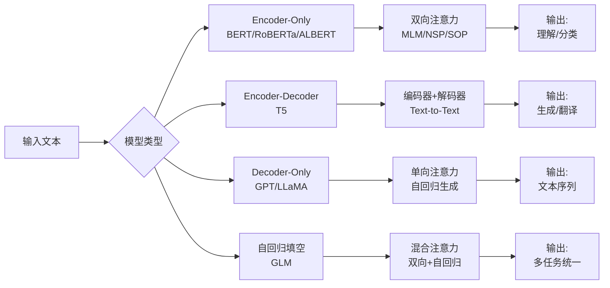

# 主流预训练语言模型网络结构与代码实现详解

基于对BERT、RoBERTa、ALBERT、T5、GPT、LLaMA和GLM的系统调研，本文从网络架构和核心代码两个维度进行深度解析，并提供完整对比。

## 📊 模型总览对比

| 模型          | 架构类型            | 核心创新点            | 参数量级      | 典型应用场景      |
| :---------- | :-------------- | :--------------- | :-------- | :---------- |
| **BERT**    | Encoder-Only    | 双向编码、MLM+NSP     | 110M-340M | 文本理解、分类、NER |
| **RoBERTa** | Encoder-Only    | 动态Mask、去NSP      | 125M-355M | 同BERT，性能更优  |
| **ALBERT**  | Encoder-Only    | 参数共享、嵌入分解        | 12M-235M  | 资源受限环境、NLU  |
| **T5**      | Encoder-Decoder | Text-to-Text统一框架 | 60M-11B   | 翻译、摘要、问答    |
| **GPT**     | Decoder-Only    | 自回归生成            | 117M-175B | 文本生成、对话     |
| **LLaMA**   | Decoder-Only    | 高效训练、RoPE        | 7B-65B    | 通用大模型、开源生态  |
| **GLM**     | 自回归填空           | 2D编码、双向-自回归混合    | 110M-130B | 中英双语、多任务    |

## 🔧 各模型网络结构与代码实现

### 1. BERT: 双向Transformer编码器

#### 网络结构

BERT采用**仅编码器**架构，由多层Transformer编码器堆叠而成。其核心组件包括：

- **嵌入层**：词嵌入 + 位置嵌入 + 分段嵌入
- **编码器层**：多头自注意力 + 前馈神经网络
- **预测头**：任务特定的分类头

```python
import torch
import torch.nn as nn
class BertEmbeddings(nn.Module):
    """BERT嵌入层：词嵌入 + 位置嵌入 + 分段嵌入"""
    def __init__(self, config):
        super().__init__()
        self.word_embeddings = nn.Embedding(config.vocab_size, config.hidden_size, padding_idx=0)
        self.position_embeddings = nn.Embedding(config.max_position_embeddings, config.hidden_size)
        self.token_type_embeddings = nn.Embedding(config.type_vocab_size, config.hidden_size)
        self.LayerNorm = nn.LayerNorm(config.hidden_size, eps=1e-12)
        self.dropout = nn.Dropout(config.hidden_dropout_prob)
    def forward(self, input_ids, token_type_ids=None):
        seq_length = input_ids.size(1)
        position_ids = torch.arange(seq_length, dtype=torch.long, device=input_ids.device)
        position_ids = position_ids.unsqueeze(0).expand_as(input_ids)
        
        if token_type_ids is None:
            token_type_ids = torch.zeros_like(input_ids)
        
        words_embeddings = self.word_embeddings(input_ids)
        position_embeddings = self.position_embeddings(position_ids)
        token_type_embeddings = self.token_type_embeddings(token_type_ids)
        
        embeddings = words_embeddings + position_embeddings + token_type_embeddings
        embeddings = self.LayerNorm(embeddings)
        embeddings = self.dropout(embeddings)
        return embeddings
class BertSelfAttention(nn.Module):
    """多头自注意力机制"""
    def __init__(self, config):
        super().__init__()
        self.num_attention_heads = config.num_attention_heads
        self.attention_head_size = int(config.hidden_size / config.num_attention_heads)
        self.all_head_size = self.num_attention_heads * self.attention_head_size
        
        self.query = nn.Linear(config.hidden_size, self.all_head_size)
        self.key = nn.Linear(config.hidden_size, self.all_head_size)
        self.value = nn.Linear(config.hidden_size, self.all_head_size)
        self.dropout = nn.Dropout(config.attention_probs_dropout_prob)
    def forward(self, hidden_states, attention_mask=None):
        query_layer = self.query(hidden_states)
        key_layer = self.key(hidden_states)
        value_layer = self.value(hidden_states)
        
        # 分头
        query_layer = query_layer.view(
            query_layer.size()[:-1] + (self.num_attention_heads, self.attention_head_size)
        ).transpose(-1, -2)
        key_layer = key_layer.view(
            key_layer.size()[:-1] + (self.num_attention_heads, self.attention_head_size)
        ).transpose(-1, -2)
        value_layer = value_layer.view(
            value_layer.size()[:-1] + (self.num_attention_heads, self.attention_head_size)
        ).transpose(-1, -2)
        
        # 计算注意力分数
        attention_scores = torch.matmul(query_layer, key_layer.transpose(-1, -2))
        attention_scores = attention_scores / math.sqrt(self.attention_head_size)
        
        if attention_mask is not None:
            attention_scores = attention_scores + attention_mask
        
        attention_probs = nn.Softmax(dim=-1)(attention_scores)
        attention_probs = self.dropout(attention_probs)
        
        context_layer = torch.matmul(attention_probs, value_layer)
        context_layer = context_layer.transpose(-1, -2).contiguous()
        context_layer = context_layer.view(
            context_layer.size()[:-2] + (self.all_head_size,)
        )
        
        return context_layer
```

#### 核心特点

- **双向上下文**：通过MLM任务学习双向语义
- **位置编码**：可学习的绝对位置编码
- **分段嵌入**：处理句子对任务（如NSP）

### 2. RoBERTa: BERT的优化版本

#### 网络结构

RoBERTa与BERT架构相同，主要改进在训练策略：

- **动态Masking**：每个Epoch重新随机Mask
- **更大batch size**：8K vs BERT的256
- **更长训练时间**：500K步 vs BERT的1M步
- **更大词表**：50K vs BERT的30K

```python
# RoBERTa动态Masking实现示例
def dynamic_masking(tokens, tokenizer):
    """动态Masking策略"""
    tokens = tokens.copy()
    num_to_mask = int(len(tokens) * 0.15)
    mask_indices = random.sample(range(len(tokens)), num_to_mask)
    
    for idx in mask_indices:
        rand = random.random()
        if rand < 0.8:  # 80%概率替换为[MASK]
            tokens[idx] = tokenizer.mask_token_id
        elif rand < 0.9:  # 10%概率替换为随机token
            tokens[idx] = random.randint(0, tokenizer.vocab_size)
        # 10%概率保持不变
    
    return tokens, mask_indices
```

### 3. ALBERT: 参数高效的轻量级模型

#### 网络结构

ALBERT通过两大创新实现参数压缩：

1. **嵌入参数分解**：将V×H分解为V×E + E×H
2. **跨层参数共享**：所有Transformer层共享参数

```python
class AlbertEmbeddings(nn.Module):
    """ALBERT嵌入层：因子化嵌入参数分解"""
    def __init__(self, config):
        super().__init__()
        # 分解的嵌入：V×E
        self.word_embeddings = nn.Embedding(config.vocab_size, config.embedding_size, padding_idx=0)
        self.position_embeddings = nn.Embedding(config.max_position_embeddings, config.embedding_size)
        self.token_type_embeddings = nn.Embedding(config.type_vocab_size, config.embedding_size)
        
        # 升维映射：E×H
        self.embedding_hidden_mapping_in = nn.Linear(config.embedding_size, config.hidden_size)
        self.LayerNorm = nn.LayerNorm(config.hidden_size, eps=1e-12)
        self.dropout = nn.Dropout(config.hidden_dropout_prob)
    def forward(self, input_ids, token_type_ids=None):
        seq_length = input_ids.size(1)
        position_ids = torch.arange(seq_length, dtype=torch.long, device=input_ids.device)
        position_ids = position_ids.unsqueeze(0).expand_as(input_ids)
        
        if token_type_ids is None:
            token_type_ids = torch.zeros_like(input_ids)
        
        words_embeddings = self.word_embeddings(input_ids)
        position_embeddings = self.position_embeddings(position_ids)
        token_type_embeddings = self.token_type_embeddings(token_type_ids)
        
        embeddings = words_embeddings + position_embeddings + token_type_embeddings
        # 关键：通过线性层升维到hidden_size
        embeddings = self.embedding_hidden_mapping_in(embeddings)
        embeddings = self.LayerNorm(embeddings)
        embeddings = self.dropout(embeddings)
        return embeddings
class AlbertLayerGroup(nn.Module):
    """共享的Transformer层组"""
    def __init__(self, config):
        super().__init__()
        # 单个共享层，供所有层复用
        self.albert_layer = AlbertLayer(config)
        self.inner_group_num = config.inner_group_num
    def forward(self, hidden_states, attention_mask=None):
        for _ in range(self.inner_group_num):
            layer_output = self.albert_layer(hidden_states, attention_mask)
            hidden_states = layer_output
        return hidden_states
class AlbertTransformer(nn.Module):
    """ALBERT Transformer编码器"""
    def __init__(self, config):
        super().__init__()
        # 所有层共享同一组参数
        self.albert_layer_groups = nn.ModuleList([
            AlbertLayerGroup(config) for _ in range(config.num_hidden_groups)
        ])
        self.num_hidden_layers = config.num_hidden_layers
        self.num_hidden_groups = config.num_hidden_groups
    def forward(self, hidden_states, attention_mask=None):
        for i in range(self.num_hidden_layers):
            # 计算当前层应该使用哪个参数组
            group_idx = int(i / (self.num_hidden_layers / self.num_hidden_groups))
            layer_group = self.albert_layer_groups[group_idx]
            hidden_states = layer_group(hidden_states, attention_mask)
        return hidden_states
```

#### 参数压缩效果

```python
# 嵌入参数对比示例
# BERT: V×H = 30522×768 ≈ 23.4M
# ALBERT: V×E + E×H = 30522×128 + 128×4096 ≈ 4.4M (xxlarge)
# 参数减少约80%
```

### 4. T5: Text-to-Text统一框架

#### 网络结构

T5采用完整的Encoder-Decoder架构，核心创新是将所有NLP任务统一为文本到文本的转换。

```python
class T5Attention(nn.Module):
    """T5注意力机制（相对位置编码）"""
    def __init__(self, config, has_relative_attention_bias=False):
        super().__init__()
        self.is_decoder = config.is_decoder
        self.has_relative_attention_bias = has_relative_attention_bias
        
        self.q = nn.Linear(config.d_model, config.inner_dim, bias=False)
        self.k = nn.Linear(config.d_model, config.inner_dim, bias=False)
        self.v = nn.Linear(config.d_model, config.inner_dim, bias=False)
        self.o = nn.Linear(config.inner_dim, config.d_model, bias=False)
        
        if self.has_relative_attention_bias:
            # 相对位置编码
            self.relative_attention_bias = nn.Embedding(
                config.relative_attention_num_buckets, 
                config.num_heads
            )
    def compute_bias(self, query_length, key_length):
        """计算相对位置偏置"""
        context_position = torch.arange(query_length, dtype=torch.long)[:, None]
        memory_position = torch.arange(key_length, dtype=torch.long)[None, :]
        
        relative_position = memory_position - context_position
        relative_position_bucket = self._relative_position_bucket(
            relative_position,
            bidirectional=(not self.is_decoder),
            num_buckets=32,
        )
        
        values = self.relative_attention_bias(relative_position_bucket)
        values = values.permute([2, 0, 1]).unsqueeze(0)
        return values
class T5LayerSelfAttention(nn.Module):
    """T5自注意力层"""
    def __init__(self, config, has_relative_attention_bias=False):
        super().__init__()
        self.SelfAttention = T5Attention(config, has_relative_attention_bias)
        self.layer_norm = T5LayerNorm(config.d_model, eps=config.layer_norm_epsilon)
        self.dropout = nn.Dropout(config.dropout_rate)
    def forward(self, hidden_states, attention_mask=None):
        normed_hidden_states = self.layer_norm(hidden_states)
        attention_output = self.SelfAttention(
            normed_hidden_states, 
            attention_mask=attention_mask
        )
        hidden_states = hidden_states + self.dropout(attention_output[0])
        return hidden_states
class T5ForConditionalGeneration(nn.Module):
    """T5条件生成模型"""
    def __init__(self, config):
        super().__init__()
        self.model_dim = config.d_model
        
        # 共享嵌入
        self.shared = nn.Embedding(config.vocab_size, config.d_model)
        
        # 编码器
        self.encoder = T5Stack(config, embed_tokens=self.shared)
        # 解码器
        self.decoder = T5Stack(config, is_decoder=True, embed_tokens=self.shared)
        
        # 输出层
        self.lm_head = nn.Linear(config.d_model, config.vocab_size, bias=False)
        
        # 权重绑定：解码器输出与嵌入共享权重
        self.lm_head.weight = self.shared.weight
```

### 5. GPT: 自回归解码器

#### 网络结构

GPT采用**仅解码器**架构，专注于自回归文本生成。

```python
class GPTAttention(nn.Module):
    """GPT自注意力（带因果掩码）"""
    def __init__(self, config):
        super().__init__()
        self.embed_dim = config.hidden_size
        self.num_heads = config.num_attention_heads
        self.head_dim = self.embed_dim // self.num_heads
        
        self.c_attn = nn.Linear(self.embed_dim, 3 * self.embed_dim)
        self.c_proj = nn.Linear(self.embed_dim, self.embed_dim)
        self.attn_dropout = nn.Dropout(config.attn_pdrop)
        self.resid_dropout = nn.Dropout(config.resid_pdrop)
    def _attn(self, query, key, value, attention_mask=None):
        # 计算注意力分数
        attn_weights = torch.matmul(query, key.transpose(-1, -2))
        attn_weights = attn_weights / math.sqrt(self.head_dim)
        
        # 因果掩码：防止看到未来信息
        seq_length = query.size(-2)
        causal_mask = torch.triu(
            torch.ones((seq_length, seq_length), dtype=torch.bool), 
            diagonal=1
        )
        attn_weights = attn_weights.masked_fill(causal_mask, -1e4)
        
        if attention_mask is not None:
            attn_weights = attn_weights + attention_mask
        
        attn_weights = nn.Softmax(dim=-1)(attn_weights)
        attn_weights = self.attn_dropout(attn_weights)
        
        return torch.matmul(attn_weights, value)
class GPT2Block(nn.Module):
    """GPT-2 Transformer块"""
    def __init__(self, config):
        super().__init__()
        self.ln_1 = nn.LayerNorm(config.hidden_size)
        self.attn = GPTAttention(config)
        self.ln_2 = nn.LayerNorm(config.hidden_size)
        self.mlp = nn.Sequential(
            nn.Linear(config.hidden_size, 4 * config.hidden_size),
            nn.GELU(),
            nn.Linear(4 * config.hidden_size, config.hidden_size),
            nn.Dropout(config.resid_pdrop),
        )
    def forward(self, hidden_states, attention_mask=None):
        residual = hidden_states
        hidden_states = self.ln_1(hidden_states)
        
        # 自注意力
        attn_outputs = self.attn(hidden_states, attention_mask)
        hidden_states = residual + attn_outputs
        
        # 前馈网络
        residual = hidden_states
        hidden_states = self.ln_2(hidden_states)
        feed_forward_hidden_states = self.mlp(hidden_states)
        hidden_states = residual + feed_forward_hidden_states
        
        return hidden_states
```

### 6. LLaMA: 高效大语言模型

#### 网络结构

LLaMA采用**仅解码器**架构，引入多项训练效率改进。

```python
class LLaMARotaryEmbedding(nn.Module):
    """旋转位置编码"""
    def __init__(self, dim, max_position_embeddings=2048, base=10000):
        super().__init__()
        inv_freq = 1.0 / (base ** (torch.arange(0, dim, 2).float() / dim))
        self.register_buffer("inv_freq", inv_freq)
        
        # 预计算cos和sin
        t = torch.arange(max_position_embeddings).float()
        freqs = torch.einsum("i,j->ij", t, self.inv_freq)
        emb = torch.cat((freqs, freqs), dim=-1)
        self.register_buffer("cos_cached", emb.cos()[None, None, :, :], persistent=False)
        self.register_buffer("sin_cached", emb.sin()[None, None, :, :], persistent=False)
    def forward(self, x, seq_len=None):
        if seq_len > self.cos_cached.shape[-2]:
            # 动态计算
            t = torch.arange(seq_len, device=x.device).float()
            freqs = torch.einsum("i,j->ij", t, self.inv_freq)
            emb = torch.cat((freqs, freqs), dim=-1)
            self.cos_cached = emb.cos()[None, None, :, :]
            self.sin_cached = emb.sin()[None, None, :, :]
        
        return (
            self.cos_cached[:seq_len].to(x.device),
            self.sin_cached[:seq_len].to(x.device),
        )
class LLaMAAttention(nn.Module):
    """LLaMA自注意力（带RoPE）"""
    def __init__(self, config):
        super().__init__()
        self.config = config
        self.hidden_size = config.hidden_size
        self.num_heads = config.num_attention_heads
        self.head_dim = self.hidden_size // self.num_heads
        
        self.q_proj = nn.Linear(self.hidden_size, self.num_heads * self.head_dim, bias=False)
        self.k_proj = nn.Linear(self.hidden_size, self.num_heads * self.head_dim, bias=False)
        self.v_proj = nn.Linear(self.hidden_size, self.num_heads * self.head_dim, bias=False)
        self.o_proj = nn.Linear(self.num_heads * self.head_dim, self.hidden_size, bias=False)
        
        self.rotary_emb = LLaMARotaryEmbedding(self.head_dim, config.max_position_embeddings)
    def apply_rotary_pos_emb(self, q, k, cos, sin):
        """应用旋转位置编码"""
        q_embed = (q * cos) + (self.rotate_half(q) * sin)
        k_embed = (k * cos) + (self.rotate_half(k) * sin)
        return q_embed, k_embed
    def forward(self, hidden_states, attention_mask=None):
        batch_size, seq_len, _ = hidden_states.shape
        
        query = self.q_proj(hidden_states)
        key = self.k_proj(hidden_states)
        value = self.v_proj(hidden_states)
        
        query = query.view(batch_size, seq_len, self.num_heads, self.head_dim).transpose(1, 2)
        key = key.view(batch_size, seq_len, self.num_heads, self.head_dim).transpose(1, 2)
        value = value.view(batch_size, seq_len, self.num_heads, self.head_dim).transpose(1, 2)
        
        # 旋转位置编码
        cos, sin = self.rotary_emb(value, seq_len)
        query, key = self.apply_rotary_pos_emb(query, key, cos, sin)
        
        # 注意力计算（含因果掩码）
        attn_output = self.scaled_dot_product_attention(
            query, key, value, attention_mask
        )
        
        attn_output = attn_output.transpose(1, 2).contiguous()
        attn_output = attn_output.view(batch_size, seq_len, -1)
        attn_output = self.o_proj(attn_output)
        
        return attn_output
```

### 7. GLM: 自回归填空模型

#### 网络结构

GLM采用独特的**自回归填空**架构，统一了理解与生成任务。

```python
class GLMAttention(nn.Module):
    """GLM注意力机制（2D编码）"""
    def __init__(self, config):
        super().__init__()
        self.hidden_size = config.hidden_size
        self.num_heads = config.num_attention_heads
        self.head_dim = self.hidden_size // self.num_heads
        
        self.q_proj = nn.Linear(self.hidden_size, self.num_heads * self.head_dim, bias=False)
        self.k_proj = nn.Linear(self.hidden_size, self.num_heads * self.head_dim, bias=False)
        self.v_proj = nn.Linear(self.hidden_size, self.num_heads * self.head_dim, bias=False)
        self.o_proj = nn.Linear(self.num_heads * self.head_dim, self.hidden_size, bias=False)
        
        # 2D位置编码
        self.position_embeddings_2d = nn.Embedding(2, config.hidden_size)
    def create_2d_mask(self, seq_len, mask_token_id):
        """创建2D掩码：区分双向与自回归部分"""
        mask = torch.zeros(seq_len, seq_len)
        # 双向部分（非mask token）
        bidirectional_mask = torch.tril(torch.ones(seq_len, seq_len))
        # 自回归部分（mask token）
        mask_token_positions = torch.where(
            torch.tensor([mask_token_id in t for t in tokens])
        )
        
        # 自回归部分只能看到之前的token
        for pos in mask_token_positions:
            mask[pos, :pos+1] = 1
        
        return mask
class GLMBlock(nn.Module):
    """GLM Transformer块"""
    def __init__(self, config):
        super().__init__()
        self.ln_1 = nn.LayerNorm(config.hidden_size)
        self.attn = GLMAttention(config)
        self.ln_2 = nn.LayerNorm(config.hidden_size)
        self.mlp = nn.Sequential(
            nn.Linear(config.hidden_size, 4 * config.hidden_size),
            nn.GELU(),
            nn.Linear(4 * config.hidden_size, config.hidden_size),
            nn.Dropout(config.resid_pdrop),
        )
    def forward(self, hidden_states, attention_mask=None):
        residual = hidden_states
        hidden_states = self.ln_1(hidden_states)
        
        # GLM特有的注意力（处理双向与自回归混合）
        attn_outputs = self.attn(hidden_states, attention_mask)
        hidden_states = residual + attn_outputs
        
        # 前馈网络
        residual = hidden_states
        hidden_states = self.ln_2(hidden_states)
        feed_forward_hidden_states = self.mlp(hidden_states)
        hidden_states = residual + feed_forward_hidden_states
        
        return hidden_states
```

## 🏗️ 架构对比图



## 📈 性能与效率对比

| 模型          | 训练效率             | 推理速度 | 参数效率  | 多语言支持 |
| :---------- | :--------------- | :--- | :---- | :---- |
| **BERT**    | 中等               | 快    | 中等    | 有限    |
| **RoBERTa** | 中等               | 快    | 中等    | 有限    |
| **ALBERT**  | 慢（参数共享）          | 慢    | **高** | 有限    |
| **T5**      | 慢（大模型）           | 慢    | 中等    | **好** |
| **GPT**     | 慢（大模型）           | 中等   | 中等    | 有限    |
| **LLaMA**   | **快**（1T+ token） | 快    | 高     | 有限    |
| **GLM**     | 中等               | 中等   | 高     | **好** |

## 🎯 总结与选择建议

### 模型选择指南

```python
def select_model_by_task(task_type, resource_constraints):
    """根据任务类型选择模型"""
    if task_type == "understanding":  # 理解任务
        if resource_constraints == "high":
            return "ALBERT"  # 参数效率最高
        else:
            return "RoBERTa"  # 性能更好
    
    elif task_type == "generation":  # 生成任务
        if resource_constraints == "high":
            return "LLaMA"  # 训练效率高
        else:
            return "GPT"  # 生成质量更好
    
    elif task_type == "multilingual":  # 多语言
        return "GLM"  # 支持中英双语
    
    elif task_type == "unified":  # 多任务统一
        return "T5"  # Text-to-Text框架
```

### 未来发展趋势

1. **架构统一**：Decoder-Only成为主流，但GLM等混合架构仍有价值
2. **效率优化**：ALBERT的思想在大模型中重新受到重视
3. **多语言支持**：GLM、T5等多语言模型重要性增加
4. **训练效率**：LLaMA证明大规模数据训练的重要性

## 🔗 参考资源

1. **官方实现**：
   - BERT: [Hugging Face Transformers](https://huggingface.co/docs/transformers/model_doc/bert)
   - ALBERT: [ALBERT-Pytorch](https://github.com/graykode/ALBERT-Pytorch)
   - T5: [Hugging Face T5](https://huggingface.co/docs/transformers/model_doc/t5)
2. **论文**：
   - BERT: [arXiv:1810.04805](https://arxiv.org/abs/1810.04805)
   - RoBERTa: [arXiv:1907.11692](https://arxiv.org/abs/1907.11692)
   - ALBERT: [arXiv:1909.11942](https://arxiv.org/abs/1909.11942)
   - T5: [arXiv:1910.10683](https://arxiv.org/abs/1910.10683)
3. **社区实现**：
   - [ALBERT完整实现](https://mbrenndoerfer.com/writing/albert-parameter-efficient-bert-factorized-embeddings/implementing-a-complete-albert-model)
   - [Hugging Face Transformers源码](https://github.com/huggingface/transformers)
     本文提供了各模型的网络结构细节和核心代码实现，可作为深入理解现代预训练语言模型的参考。实际应用中建议结合具体任务需求和资源约束选择合适的模型。
